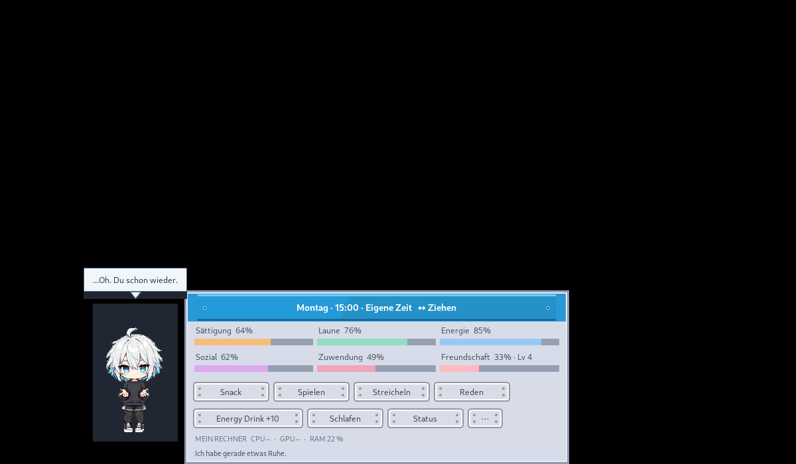

# Aiko Desktop Pet

**Aiko is a small, expressive Chibi personification of your computer.** She lives near the Windows taskbar, walks around, follows the cursor, develops needs and friendships, and reacts to both your attention and the work her computer is doing.

**Current release: v0.13** · Windows 10/11 · Python 3.11+ · no account, AI inference service, subscription, or cloud connection required.



[Watch an actual emote → dialogue → emote sequence](vorschau/Aiko_v0_13_Reaktionsablauf.gif)

> **Language:** The game interface and Aiko's spoken text bubbles are currently in **German**. All project documentation is in **English**.

## Features

- **Desktop companion:** Aiko walks along the taskbar, jumps, waves, and follows the mouse with 16 directional gaze sprites.
- **Tamagotchi-style care:** Five short-term needs—satiety, mood, energy, social interaction, and affection—plus a long-term friendship level.
- **Care actions:** Feed, play, talk, pet, sleep/wake, and an energy drink that restores 10 energy points per use.
- **Personality:** Handwritten German dialogue responds to mood, time of day, recent events, repeated clicks, and interruptions. Aiko is observant, reserved, subtly sarcastic, and occasionally awkwardly funny.
- **Expression sequences:** Context-specific Kenney emotes and speech appear **in sequence**, never simultaneously: emote → text → optional follow-up → emote.
- **Adaptive activity:** Aiko distinguishes running time from actual work, observes CPU/GPU activity and memory signals, and gradually learns locally aggregated weekly usage patterns.
- **Movable sci-fi panel:** Six status indicators, care buttons, a settings menu, and an independently positioned speech bubble. The panel appears on hover and can be dragged elsewhere.

## Run on Windows

**Requirements:** Windows 10 or 11 and Python 3.11 or later with Tkinter.

1. [Download the repository as a ZIP](https://github.com/Lexoniarus/aiko-desktop-pet/archive/refs/heads/main.zip) and extract it to a local folder.
2. Double-click `Aiko_starten.bat`, or run `python main.py` in a terminal
   from the project folder. You can also use `python -m aiko_pet`.
3. Hover over Aiko to view needs and care actions.
4. If startup fails, run `Aiko_starten_debug.bat` to see console errors.

### Optional local .env configuration

No environment file is required, and there are no API keys or secrets.
If you want to choose a different save-file path, copy `.env.example` to `.env`
and set `AIKO_SAVE_PATH` to the desired file (not just a directory). All three
entry points use the same optional configuration. Existing operating-system
environment variables take precedence. Without an override, saves remain at
`%LOCALAPPDATA%\AikoDesktopPet\state.json` on Windows.
The `.env` file is ignored by Git and is never published.

No additional Python packages are required to run the game. If **Kenney Mini** is already installed locally, the application can use it; otherwise it falls back to Segoe UI. Font files are not distributed in this repository.

Saved progress is stored outside the repository at `%LOCALAPPDATA%\AikoDesktopPet\state.json`; upgrades preserve existing saves.

## Tests

Run the unit and graphical tests in an environment with a display:

```bash
python -m unittest discover -s tests -q
```

On Linux, a virtual X11 display can be used:

```bash
xvfb-run -a python -m unittest discover -s tests -q
```

The v0.13 release passed **231 tests** under Linux/Xvfb. This does **not** replace real Windows testing of taskbar positioning, window layering, microphone overlays, GPU telemetry, or long-term balance. GitHub Actions runs the test suite for commits and pull requests.

## Project structure

| Location | Purpose |
| --- | --- |
| `aiko_pet/application/` | Typed use cases, command routing and bounded integration notifications |
| `aiko_pet/application/settings.py` | Runtime preferences independent of JSON persistence |
| `aiko_pet/application/session.py` | Startup restoration and bounded catch-up for existing saves |
| `aiko_pet/storage.py` | Versioned JSON decoding/encoding with legacy settings exports |
| `aiko_pet/ui/animated_pet.py` | The animated character: sprites, gaze and movement |
| `aiko_pet/ui/hover_ui.py` | Independent owner of the hover, status and settings windows |
| `aiko_pet/ui/` | Independent Tk views plus speech/emote presenter and typed callback contracts |
| `aiko_pet/application/read_snapshot.py` | Immutable, language-neutral pet read snapshot |
| `aiko_pet/application/ports.py` | Structural hardware-reading capabilities for application services |
| `aiko_pet/presentation/` | German desktop copy, display models, hover/status projections and geometry |
| `aiko_pet/application/view_models.py` | Legacy import bridge for presentation contracts |
| `aiko_pet/application/read_models.py` | Constructs read-only utility snapshots |
| `aiko_pet/desktop/runtime.py` | Owns the update phases and Tk timers |
| `aiko_pet/desktop/persistence.py` | Writes current state and tracks autosave timing |
| `aiko_pet/desktop/maintenance.py` | Bounded taskbar and z-order checks |
| `aiko_pet/desktop/input.py` | Tk bindings and global mouse/focus input |
| `aiko_pet/desktop/lifecycle.py` | Ordered startup and shutdown of desktop resources |
| `aiko_pet/desktop/compatibility.py` | Typed forwards for older desktop calls |
| `aiko_pet/adaptive.py` + `adaptive_models.py` | Runtime learning controller and serializable data contracts |
| `aiko_pet/gui.py` | Desktop component assembly; startup and shutdown delegated |
| `aiko_pet/telemetry.py` | Immutable workload sample and hardware-independent effort calculation |
| `aiko_pet/infrastructure/hardware/` | CPU/RAM/uptime providers, NVIDIA parsing, sampler and background monitor |
| `aiko_pet/system_activity.py` | Backward-compatible hardware imports (no extra logic) |
| `aiko_pet/work_episode.py` | Observed work episodes, interruptions and bounded recovery dialogue context |
| `aiko_pet/domain.py` | PetState aggregate: sole owner of pet need, care, friendship and routine mutations |
| `aiko_pet/care_actions.py` + `need_decay.py` | Pure care decisions and need-decay calculations |
| `aiko_pet/friendship.py` + `pet_lifecycle.py` | Pure relationship and bounded timeline transition calculations |
| `aiko_pet/` | Existing domain, storage and offline dialogue policies |
| `aiko_pet/assets/frames/` | 73 original Aiko character animation frames |
| `aiko_pet/assets/emotes/` | Kenney pixel emotes |
| `aiko_pet/assets/kenney_ui/` | Kenney-based sci-fi panels and controls |
| `aiko_pet/data/dialogues.de.json` | German dialogue catalog; intentionally not translated |
| `tests/` | Unit and GUI tests |
| `docs/` | English technical documentation, history, and test reports |
| `vorschau/` | Real application screenshots and GIF previews |

## Licensing and attribution

- **Project source code and project-authored Aiko image assets** are offered under the [MIT License](LICENSE), to the extent the project author controls licensable rights in them.
- The Aiko sprite artwork was made using OpenAI image-generation tools in the creator's Codex-based asset workflow. The sprites are **not** subject to a separate invented “OpenAI image license.” See [ASSETS.md](ASSETS.md) for provenance and limitations.
- **Kenney Emote Pack** and **Kenney UI Pack: Sci-fi** assets are made available under **CC0 1.0**. The creator obtained them through a purchased Kenney All-in-1 bundle. Credit is optional under CC0 and is gladly provided here: **Assets by [Kenney](https://kenney.nl/)**. See [Kenney credits](LICENSES/KENNEY_CC0.md).
- **Fonts** are not bundled; locally installed fonts retain their own terms.

Aiko Desktop Pet is an independent hobby project and does not require ComfyReview or Character Chronicles.
