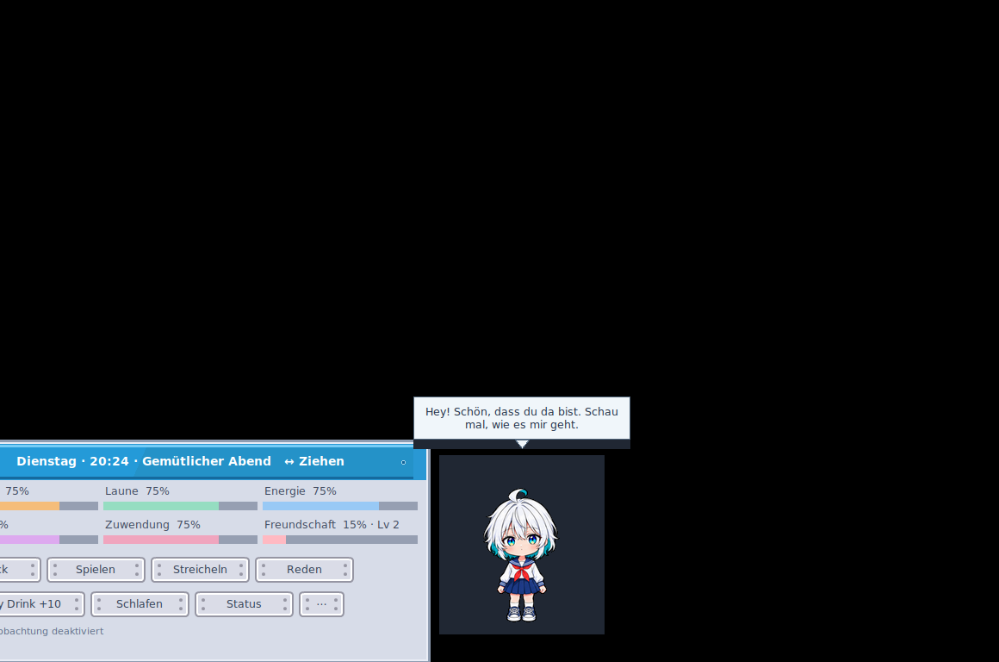
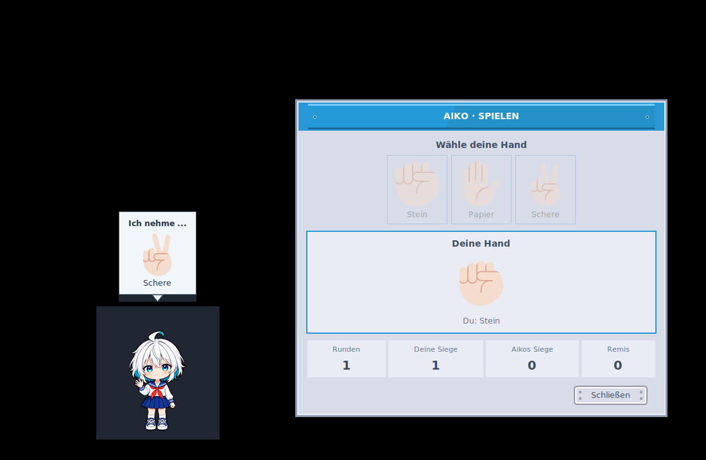
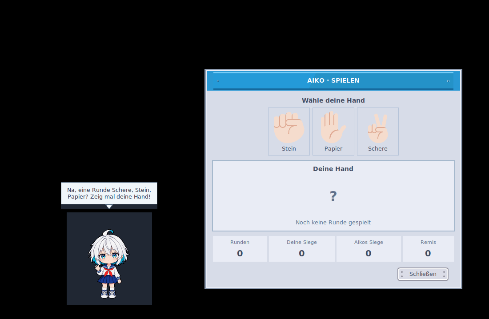
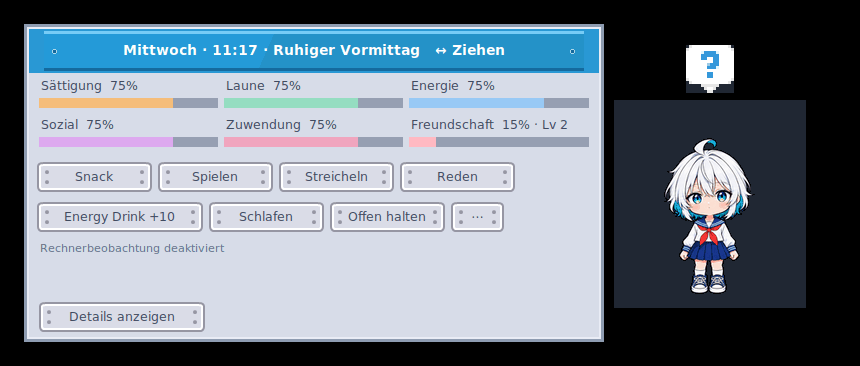

> **World feature test:** Hold a food/drink choice to carry one portion, then
> offer it on release or drop it onto the taskbar ground. Aiko can notice,
> approach, pick up and consume wanted objects. Resting portions can be moved;
> drops settle with damped hops inside normal reach. Try the isolated
> [test starter](Aiko_World_Test.bat) and [practical checklist](docs/WORLD_SMOKE_TEST.md).
> Native practical acceptance is still pending on the feature branch.

# Aiko Desktop Pet

**A small, expressive desktop companion that lives by your Windows taskbar.** Aiko is a chibi personification of your computer: she walks, notices your attention, reacts to measured work, and gradually develops a familiar routine and friendship with you.

[](https://github.com/Lexoniarus/aiko-desktop-pet/actions/workflows/tests.yml)
[](LICENSE)
[](#getting-started)

**Windows 10/11 · Python 3.11+ · local-first · no cloud account or AI API.**



*Actual Tk application capture on Linux/Xvfb (not a native Windows desktop
screenshot). The current 112-pose Anime character, Kenney panel, and German
dialogue are shown together. Documentation is in English.*

## Play with Aiko (Rock–Paper–Scissors)

Aiko's character bubble shows **only her own choice** and her reactions.
The independent, always-open Kenney-styled player panel shows **your selected
hand**, the round counter, your wins, Aiko's wins and draws. The counters belong
only to the currently opened minigame window and are never saved.

Other games, libraries and external data sources have been discussed only as
**unapproved possibilities**, with **no selected next game or implementation
order**. See the [minigame candidate catalogue and integration research](docs/MINIGAME_CANDIDATES.md).





*These are captures of the actual Tk application on Linux/Xvfb;
they are not native Windows screenshots.*

## See Aiko in action



This reaction sequence uses the **current character sprites, speech presenter and
Kenney emotes**. A separate [idle behavior preview](vorschau/Aiko_Current_Ambient_Blink_And_Glance.gif)
shows occasional complete blinks, **subtle pose-relative head motion between
blinks**, and autonomous gaze without mouse movement. The feet stay anchored,
including when Aiko looks to either side. The sprite-only [animation catalog](vorschau/Aiko_Current_Animations.gif)
shows the original 112 poses; the new pickup adds eight poses to the runtime.

[Browse the six retained screenshots and GIFs →](docs/MEDIA_GALLERY.md)

Historical v0.7–v0.13 artwork remains in Git history, not in the current
preview gallery.

## What she does

- **Lives on your desktop.** Short, slower taskbar walks with 1–3 minute pauses, intermittent blinking, spontaneous glances, jumping, waving, resting and 16-direction cursor gaze.
- **Needs a little care.** Feed, play Rock–Paper–Scissors, talk, pet, sleep/wake or offer an energy drink. Meals and snacks provide different satiety and digestion effects. Enjoyment, social needs and affection develop separately, with occasional friendly requests.
- **Has her own voice.** Handwritten German reactions vary with mood, time, repeated clicks, interruptions and recent interactions. Authored stories vary across four friendship stages and current needs. Talk plays several bubbles with emotes and pauses; left-click Aiko to advance a story.
- **Notices actual workload.** Local CPU/GPU and memory observations inform her working/resting behavior, without inventing the application or task you are using. Missing sensors remain unknown.
- **Learns a gentle rhythm.** Locally aggregated activity evidence helps her adapt to regular working and resting periods.
- **Stays out of the way.** One draggable sci-fi care toolbar with an optional visibility pin, inline status details, persistent settings and a separate speech bubble. See the [window contract](docs/UI_WINDOW_CONTRACT.md).

This source builds on the **v0.13 feature baseline and modular OOP refactor**, with a 120-pose Aiko Anime character set, per-frame timing, pickup/put-down, eating, petting and sleeping animations. Attack artwork is stored for later use. A Windows setup script is included in the source; there is currently no separate packaged executable installer or published GitHub Release.

## Getting started

1. [Download the current `main` source ZIP](https://github.com/Lexoniarus/aiko-desktop-pet/archive/refs/heads/main.zip) and extract the complete folder to a writable, permanent location on Windows 10/11. Rock–Paper–Scissors is already included in `main`.
2. Double-click **[`Aiko_installieren.bat`](Aiko_installieren.bat)**. Setup tests Python 3.11+ and a real Tk window. If the runtime is missing or incomplete, it downloads the official Python 3.13 installer and installs Tcl/Tk for your Windows account; WinGet is unnecessary. It creates an isolated `.venv`, processes [`requirements.txt`](requirements.txt), checks character assets, and creates desktop/Start menu shortcuts. An internet connection is needed if Python or future runtime packages must be downloaded.
3. Use the **Aiko Desktop Pet** shortcut or double-click `Aiko_starten.bat`. With an existing suitable Python installation, you can also skip setup and run:

   ```powershell
   py -m aiko_pet
   ```

4. Hover over Aiko to open the care panel. If the window fails to start, use `Aiko_starten_debug.bat` to keep the error output visible.

You can also run `python main.py` or `python -m aiko_pet`. **No third-party Python packages are currently required for normal use.** Windows itself does not include Python or Tkinter. Tcl/Tk is installed as a Python component by setup; it is not a pip package. The launchers prefer the local environment. Keep the extracted folder in place after setup. [Setup options, troubleshooting and removal →](docs/WINDOWS_SETUP.md)

If the optional Kenney Mini font is already installed, Aiko can use it; otherwise she falls back to Segoe UI. Font files are not redistributed.

### Saves and optional configuration

By default, Aiko stores progress outside the repository at:

```text
%LOCALAPPDATA%\AikoDesktopPet\state.json
```

**No `.env` file is needed.** The only optional setting is `AIKO_SAVE_PATH`, which changes the save *file* location. To use it, copy [.env.example](.env.example) to a local `.env` and edit the value. An existing OS environment variable takes precedence. The template contains no secrets and should remain unmodified when no override is wanted.

## Privacy and local data

Aiko runs locally. The current application does **not** send telemetry to a server, start an HTTP service, require a subscription or call an external AI inference API.

Her workload observations are drawn from local CPU/GPU utilization, memory pressure, uptime and user-idle timing. They do not inspect files, process/application names, browser content, typed text or microphone input. Optional NVIDIA sampling uses local OS tooling. Learned rhythm summaries and pet progress are stored locally in the save file.

Needs progress during the running session. Reopening also reconstructs closed
time, up to eight hours by default. With automatic routine enabled, Aiko sleeps
and eats due main meals during this reconstruction. Live supply uses offered
or autonomously collected World portions. Live PC suspend is excluded from the running-session clock.
[Save format, backups, time rules and editable JSON data →](docs/DATA_AND_SAVES.md)
The real clock still determines meals and daily routine. Friendship remains a
separate, slowly earned bond with the existing daily limits.

Disable **Observe computer** or **Learn rhythm** individually from the settings panel if you do not want those behaviors. See [rhythm and dialogue ownership](docs/ARCHITECTURE.md#rhythm-and-dialogue) for the current implementation.

## For developers

The source is organized by responsibility rather than by window or feature version:

| Package | Owns |
| --- | --- |
| `aiko_pet/pet/` | The PetState aggregate, care rules, needs, friendship and daily routine |
| `aiko_pet/world/` | Concrete portions, custody, reachable geometry and analytic drop/rebound motion |
| `aiko_pet/pet/mind/` | Dialogue selection, personality, adaptive habits and workload events |
| `aiko_pet/application/` | Typed use cases, attention/activity coordination and read contracts |
| `aiko_pet/ui/view_models/` | German display text and immutable UI projections |
| `aiko_pet/ui/` | Tkinter character, one pinnable care toolbar, persistent settings, speech and shared window components |
| `aiko_pet/desktop/` | Tk runtime, native Windows window/input handling and preferences |
| `aiko_pet/infrastructure/` | Hardware providers and versioned local JSON persistence |

The bootstrap is `aiko_pet/gui.py`. Imports use the owning packages directly; obsolete flat-module paths have been removed. See the architecture guide for the import migration table. [Architecture and dependency rules →](docs/ARCHITECTURE.md)

### Tests

```bash
python -m unittest discover -s tests -q
```

GUI tests require a display; on Linux use `xvfb-run -a python -m unittest discover -s tests -q`. [GitHub Actions](https://github.com/Lexoniarus/aiko-desktop-pet/actions/workflows/tests.yml) runs Python 3.11/3.13 under Linux/Xvfb, Windows headless regressions, Ruff, strict Mypy and Pyright. Real Windows window behavior was also checked by the project maintainer during the October 2026 refactor.

See [Contributing](CONTRIBUTING.md), the [current change history](CHANGELOG.md),
[development workflow](docs/GITHUB_WORKFLOW.md), and the historical milestones
in the change history.

## Artwork, fonts and licensing

- **Project code** is under the [MIT License](LICENSE).
- **Current Aiko Anime character assets** have [restricted reuse terms](assets/aiko-anime-8-frames/LICENSE.md), separate from MIT. Use in Aiko Desktop Pet is allowed; other reuse and redistributed forks containing these assets require Alex's explicit consent. The previous sprite release retains its earlier MIT designation. See [asset provenance](ASSETS.md).
- **Kenney Emote Pack and UI Pack: Sci-fi** artwork is [CC0 1.0](LICENSES/KENNEY_CC0.md), with voluntary credit to [Kenney](https://kenney.nl/).
- **Font binaries are not shipped** and are not relicensed by this project.

Please consult [ASSETS.md](ASSETS.md) for provenance, attribution and limitations.
Security and private vulnerability reporting are explained in
[SECURITY.md](SECURITY.md).

Aiko Desktop Pet is an independent project, separate from ComfyReview and
Character Chronicles.
