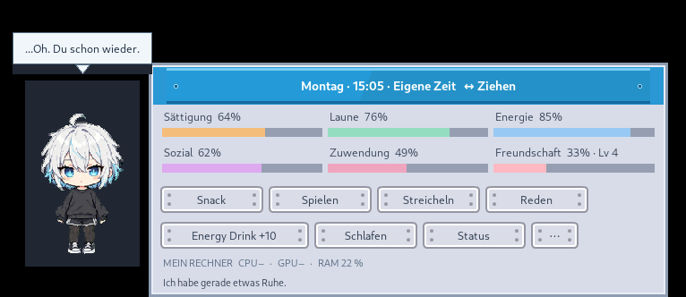
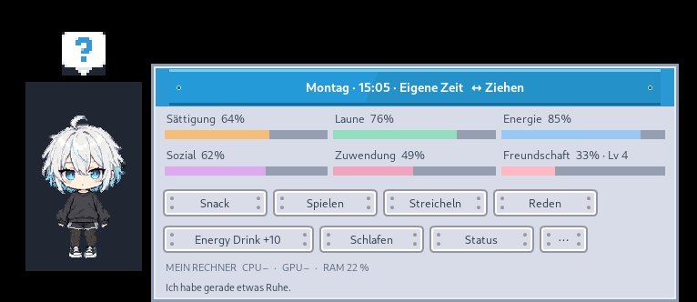

# Aiko Desktop Pet

**A small, expressive desktop companion that lives by your Windows taskbar.** Aiko is a chibi personification of your computer: she walks, notices your attention, reacts to measured work, and gradually develops a familiar routine and friendship with you.

[](https://github.com/Lexoniarus/aiko-desktop-pet/actions/workflows/tests.yml)
[](LICENSE)
[](#getting-started)

**Windows 10/11 · Python 3.11+ · local-first · no cloud account or AI API.**



*Real application capture. Interface and Aiko's authored dialogue are in German; project documentation is in English.*

## See Aiko in action



[More real screenshots, sprite animations and earlier versions →](docs/MEDIA_GALLERY.md)

## What she does

- **Lives on your desktop.** Animated taskbar walking, jumping, waving, resting and 16-direction cursor gaze.
- **Needs a little care.** Feed, play, talk, pet, sleep/wake or offer an energy drink. Five short-term needs and a separate, gradually earned friendship level influence her behavior.
- **Has her own voice.** Handwritten German reactions vary with mood, time, repeated clicks, interruptions and recent interactions. Emotes, text and optional follow-ups play in sequence.
- **Notices actual workload.** Local CPU/GPU and memory observations inform her working/resting behavior, without inventing the application or task you are using. Missing sensors remain unknown.
- **Learns a gentle rhythm.** Locally aggregated activity evidence helps her adapt to regular working and resting periods.
- **Stays out of the way.** A draggable sci-fi hover toolbar, independent status/settings windows and a separate speech bubble.

This is the **v0.13 feature baseline with the completed modular OOP refactor on `main`**. It is a source project; there is currently no separate packaged Windows installer or published GitHub Release.

## Getting started

1. Install **Python 3.11 or newer** on Windows 10 or 11, including Tkinter (normally part of the standard Windows Python installer).
2. [Download the current source ZIP](https://github.com/Lexoniarus/aiko-desktop-pet/archive/refs/heads/main.zip), extract it, and open the extracted folder.
3. Double-click `Aiko_starten.bat`, or open a terminal in that folder and run:

   ```powershell
   py -m aiko_pet
   ```

4. Hover over Aiko to open the care panel. If the window fails to start, use `Aiko_starten_debug.bat` to keep the error output visible.

You can also run `python main.py` or `python -m aiko_pet`. **No `pip install` is required for normal use.** If the optional Kenney Mini font is already installed, Aiko can use it; otherwise she falls back to Segoe UI. Font files are not redistributed.

### Saves and optional configuration

By default, Aiko stores progress outside the repository at:

```text
%LOCALAPPDATA%\AikoDesktopPet\state.json
```

**No `.env` file is needed.** The only optional setting is `AIKO_SAVE_PATH`, which changes the save *file* location. To use it, copy [.env.example](.env.example) to a local `.env` and edit the value. An existing OS environment variable takes precedence. The template contains no secrets and should remain unmodified when no override is wanted.

## Privacy and local data

Aiko runs locally. The current application does **not** send telemetry to a server, start an HTTP service, require a subscription or call an external AI inference API.

Her workload observations are drawn from local CPU/GPU utilization, memory pressure, uptime and user-idle timing. They do not inspect files, process/application names, browser content, typed text or microphone input. Optional NVIDIA sampling uses local OS tooling. Learned rhythm summaries and pet progress are stored locally in the save file.

Disable **Observe computer** or **Learn rhythm** individually from the settings panel if you do not want those behaviors. See [adaptive behavior notes](docs/ADAPTIVER_RHYTHMUS.md) for details and historical design context.

## For developers

The source is organized by responsibility rather than by window or feature version:

| Package | Owns |
| --- | --- |
| `aiko_pet/pet/` | The PetState aggregate, care rules, needs, friendship and daily routine |
| `aiko_pet/personality/` | Dialogue selection, personality, adaptive habits and workload events |
| `aiko_pet/application/` | Typed use cases, attention/activity coordination and read contracts |
| `aiko_pet/presentation/` | German UI text, visual policies and reaction playback |
| `aiko_pet/ui/` | Tkinter character, hover, status, settings and speech widgets |
| `aiko_pet/desktop/` | Tk runtime, native Windows window/input handling and preferences |
| `aiko_pet/infrastructure/` | Hardware providers and versioned local JSON persistence |

The bootstrap is `aiko_pet/gui.py`. Former flat-module paths remain as compatibility imports, not parallel implementations. [Architecture and dependency rules →](docs/ARCHITECTURE.md)

### Tests

```bash
python -m unittest discover -s tests -q
```

GUI tests require a display; on Linux use `xvfb-run -a python -m unittest discover -s tests -q`. [GitHub Actions](https://github.com/Lexoniarus/aiko-desktop-pet/actions/workflows/tests.yml) runs Python 3.11/3.13 under Linux/Xvfb, Windows headless regressions, Ruff, strict Mypy and Pyright. Real Windows window behavior was also checked by the project maintainer during the October 2026 refactor.

See [Contributing](CONTRIBUTING.md), the [current change history](CHANGELOG.md),
[development workflow](docs/GITHUB_WORKFLOW.md), and
[historical feature notes](docs/HISTORY_0_2_TO_0_13.md).

## Artwork, fonts and licensing

- **Project code** is under the [MIT License](LICENSE).
- **Aiko character sprites** are generated/project-authored artwork; the creator offers the licensable rights they control under MIT, subject to the qualifications in [asset provenance](ASSETS.md).
- **Kenney Emote Pack and UI Pack: Sci-fi** artwork is [CC0 1.0](LICENSES/KENNEY_CC0.md), with voluntary credit to [Kenney](https://kenney.nl/).
- **Font binaries are not shipped** and are not relicensed by this project.

Please consult [ASSETS.md](ASSETS.md) for provenance, attribution and limitations.
Security and private vulnerability reporting are explained in
[SECURITY.md](SECURITY.md).

Aiko Desktop Pet is an independent project, separate from ComfyReview and
Character Chronicles.
