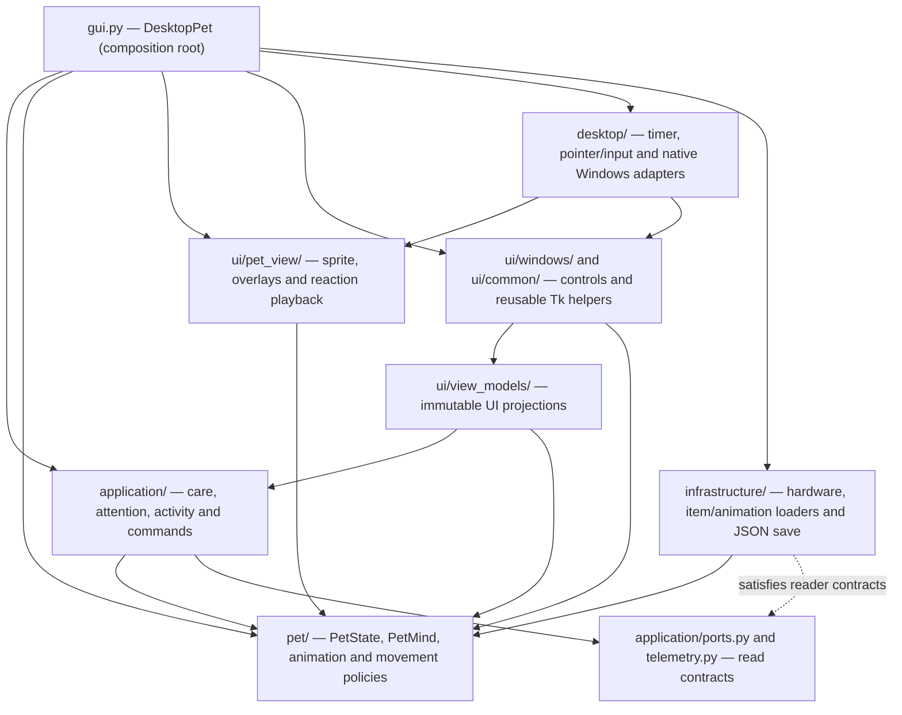

# Architecture — canonical pet and desktop UI packages

Aiko Desktop Pet is a local-first Windows companion built with Python 3.11+, Tkinter and prepared PNG artwork. The program requires no remote services or inference model at runtime. This document describes the **current code structure**, not the original v0.7–v0.13 implementation history.

The key design principle: **one owner per mutable state or external side effect**, with small, named interfaces between components. Imports point directly to the packages that own each responsibility.

The [object focus correction plan](OBJECT_FOCUS_CORRECTION_PLAN.md) records
committed investigation, observed withholding, resumption and friendship rules.

The accepted [persistent object knowledge plan](OBJECT_MEMORY_IMPLEMENTATION_PLAN.md)
extends subjective memory and remembered supply retrieval in small delivery steps.

The agreed [offer, placement and search follow-up plan](OBJECT_PLACEMENT_AND_SEARCH_PLAN.md)
records delivery of assessed cursor offers, movable portions, reachable
placement with impact-dependent damped hops, and subjective stock/search
reconciliation. The implementation below describes these owners; the plan records
commit evidence and the remaining practical acceptance.
The follow-up explicitly selects a small owned analytic motion policy over
Pymunk: pure World calculations, existing active-time scheduling and immutable
checkpoints, with no additional runtime dependency.

## Dependency overview

The solid arrows highlight major code dependencies; the dotted provider-to-port
relationship represents structural compatibility, **not** an import from
infrastructure into the application. The checked-in tests enforce
additional import rules. Platform-level coordination intentionally happens
in the desktop shell; the architecture does not pretend to eliminate
all runtime coupling between composed services.

## State and business rules

**`pet/state.py — PetState`** is the only mutable, persisted pet aggregate. Its public `interact(action, now=...)` and `advance(now, ...)` operations commit care and elapsed-time state changes. Pure policy modules in `pet/` calculate immutable decisions:

`interact()` returns a language-neutral `CareResult` from `pet/care_result.py`.
The one care decision owns acceptance, consumption, the chosen food and meal
credit. Application outcomes expose that same result; they never recalculate
satiety or energy thresholds. `application/active_time.py` owns the immutable
`SessionInputs` record used by ticks, care and completed games. Its
`advance_session_time()` function consumes the shared clock interval exactly
once and forwards the same schedule, workload and nutrition context. The mind
captures pre-care tone and conversation context before mutation, then
interprets the committed effect.
German fallback wording is selected only by `ui/view_models/care_text.py`.

- `care_actions.py`: `CareTransition` for care actions and their rewards.
- `need_decay.py`: `NeedLevels` for time and measured effort.
- `friendship.py`: relationship gains, cooldowns and daily limits.
- `lifecycle.py` and `routine.py`: bounded catch-up, sleep and daily schedule.

Food and localized UI content now have distinct, validated JSON owners:
`data/balance.json` holds the initial values and named gameplay parameters;
`data/food_catalog.json` holds nutrition/menu records;
`data/texts.de.json` holds care, mood, emotion, workload, status and
game-message copy; `data/routine.de.json` holds day schedules;
`data/dialogues.de.json` holds authored situational lines.
`assets/items/items.json` holds only item paths, dimensions, pivots and
weapon labels, not duplicate food names or menu icon conventions.
`desktop/animation_assembly.py` loads one immutable `ItemCatalog` and
shares it with the hand overlay and food picker via typed UI values. Python
food/status catalog models validate resource data; they do not define a
second, independently editable list of food profiles or emotions.
`pet/catalog_validation.py` rejects malformed JSON, duplicate keys and
non-finite numbers. Typed catalogues reject missing/unknown fields, invalid
references, text placeholders and inconsistent balance ranges before use.
See [resource ownership and local saves](DATA_AND_SAVES.md).

**`pet/mind/mind.py — PetMind`** selects reactions and maintains short-term conversational context. It does not own Tk windows or play sounds. `WorkloadEventDetector` in `pet/mind/workload_events.py` converts observed load changes into event keys. Authored Aiko dialogue remains in `aiko_pet/data/dialogues.de.json`; it is not regenerated by this refactor.

**`pet/mind/adaptive.py`** learns coarse local daily patterns from observations. Unknown hardware readings do not become fabricated activity. No application names, process titles or content are collected for this version.

`PetState.mood_hint()` now returns a typed `MoodHint` key from
`pet/status_hints.py`. The exact same pure policy works on the immutable
`PetReadSnapshot`; only `ui/view_models/text_de.py` selects German mood
wording. `PetState.due_meal()` returns a due meal ID, and the UI decides
whether to display a meal name or "Snack". Historical localized helpers
`TimeContext.label`, `TimeContext.schedule_line` and
`TimeContext.greeting()` have been removed; localized weekday/status display
belongs to `ui/view_models/text_de.py`.

## Application layer

- `CareController.execute()` advances pet time, coordinates the character's care event, applies the command and returns a presentation-independent `CareOutcome`.
- `ContactCoordinator` coordinates intentional cursor entry, user clicks and startup greetings through UI effect ports. `PetMind` still chooses all authored dialogue.
- `ApplicationRouter` accepts owner-thread care commands and validated, bounded incoming notifications. An external HTTP or IPC server is **not implemented**.
- `ActivityCoordinator` consumes hardware samples and coordinates adaptive observations and elapsed-time pet state.
- `AttentionCoordinator` controls spontaneous lines, non-interrupting notifications and idle gestures.
- `PetSessionRestorer` restores saved data through a narrow reader port, then simulates bounded closed time with unknown workload and optional routine self-care before anchoring the live clock.
- `PetReadSnapshot` is an immutable, language-neutral copy for presentation and potential future read-only adapters.
- `application/ports.py` describes capabilities such as `ComputerReadings`, not concrete OS drivers.
- `application/assembly.py` builds the single care/game/activity/cursor
  use-case graph using existing state, mind and active-session clock. The
  assembly imports no desktop, Tk, or infrastructure implementations.

The application never imports Tkinter or native system monitor implementations.

## Pet animation, UI views and Tk widgets

Pet-owned pure behaviour lives in `pet/animation/` and `pet/movement/`:
`gaze.py` computes sixteen directional sectors, `ambient.py` schedules
subtle idle motion, `animation.py` owns frame-selection and timing policies,
`timing.py` validates already-decoded animation profiles, and the
`RandomWalkPlanner` selects departures separately from the `WalkController`'s
movement execution. `pet/mind/cursor_attention.py` retains only short-lived
pointer-attention timestamps, not operating-system access.

`ui/pet_view/` owns the concrete renderer and overlays:

- `AnimatedPet` owns Tk frame playback, sprite caches, overlays and
  per-frame animation callbacks. Its `render()` applies a typed
  `RenderDecision`; it no longer chooses behavioural priority, reads
  hardware, owns gaze history or constructs a walking controller.
- `DesktopAnimationRuntime` (`desktop/animation_runtime.py`) composes pure
  pet animation policies, attention timing and already observed host facts.
  Its single `AmbientDirector` is passed into `AnimatedPet` for head sway
  and complete blink-frame playback without duplicating ambient state.
- `DesktopVisualObservation` (`desktop/visual_observation.py`) owns
  16-direction gaze hysteresis and reads cached workload only when needed.
- `WalkDriver` (`desktop/walk_runtime.py`) translates host placement and
  the current attention/work situation into steps from the single pet-owned
  `WalkController`. Tk frame callbacks still advance movement smoothly.
- `CharacterSpriteCache` handles runtime sprite frames, including lazy 2x
  variants. `RestPoseRenderer` handles pose-relative head motion, and
  `FoodOverlay` renders the selected hand item without affecting nutrition.

At shutdown, the lifecycle closes `AnimatedPet` before destroying Tk. The sprite
owner releases original/zoomed/rest-pose images and its food overlay on Tk's
thread; delayed background garbage collection does not own those image effects.
- `SpeechPresenter` and `ReactionPlayer` display timed text and emote cues.
  The pure need-based idle emote choice lives under `pet/animation/`.
- `ActionPlayback` owns the current visual action state and deadline, not the
  desktop shell. `CarePresenter` renders accepted care outcomes, including
  held items, reactions and status refreshes. `AttentionPresenter` translates
  approved spontaneous speech, idle gestures and notifications into visuals.

`ActionPlayback.clip_id` identifies the running animation clip; it is distinct
from the pet aggregate and its needs. `CarePresenter` uses the result's action
and consumed item directly instead of accepting a second copy of that action.

`ui/windows/` owns `HoverUi`, the pinnable `ActionToolbar`, `FoodMenu`,
`SettingsWindow`, and the rock-paper-scissors window. Controls are
independently movable where applicable. `ui/common/` owns reusable skin and
window-dragging helpers; `ui/view_models/` owns `DesktopPresentation`,
immutable status/hover/settings contracts, projections and localized UI copy.

No user-facing window owns PetState transitions. Actions are sent to the
application boundary through named callbacks. The pet sprite and the utility
windows are distinct UI owners even though both use Tkinter.

`presentation/`, `personality/` and the former root-level `ui/*.py` widget
forwarders have been **removed**. Runtime and tests import directly from the
owning `pet/`, `ui/`, or `infrastructure/` module. See the
[UI window contract](UI_WINDOW_CONTRACT.md).

## Desktop runtime and operating-system adapters

`gui.DesktopPet` is the composition root. It wires typed callbacks and starts
`DesktopLifecycle` without owning a duplicate application or animation state.
`desktop/animation_assembly.py` constructs the interdependent WalkDriver,
visual observer, animation runtime and sprite as one bounded assembly.
`desktop/session_runtime.py` coordinates lifecycle advancement, window
refresh and the advance-before-persist sequence through narrow effect ports.

- `DesktopRuntime` takes explicit `DesktopTickPorts` and owns the ordered 140 ms update cycle and timer IDs.
- `DesktopAnimationRuntime` chooses sprite intent without importing Tk.
  `WalkDriver` executes bounded host displacement, while
  `DesktopVisualObservation` resolves cursor and measured workload inputs.
- `DesktopPreferences` coordinates the consequences of option changes without a second settings model.
- `application/settings.py` defines `PetSettings` as the single settings
  aggregate, composing `PetBehaviorSettings` and `DesktopDisplaySettings`.
  The historical flat properties and version-one JSON keys are preserved; no
  preference value is duplicated between the two child objects.
- `DesktopInput` owns Tk bindings, global click checks, pointer-coordinate sampling and cancellable delayed focus callbacks.
- `DesktopLifecycle` controls startup/shutdown ordering.
- `desktop/taskbar.py` and `window_stack.py` own Windows-specific taskbar discovery and z-order operations; `desktop/geometry.py` contains pure taskbar value calculations.

`infrastructure/character_assets.py` reads the prepared character catalog into immutable `pet/animation/character.py` contracts before Tk widgets are constructed. `infrastructure/animation_timing.py` owns JSON decoding while pure validation is in `pet/animation/timing.py`. Full-width frames and visible ground anchors preserve the wider sleeping pose. `tools/prepare_character_assets.py` retains the selected rebuild inputs and produces binary-alpha runtime PNGs. Runtime metadata retains historical source durations while each regular clip uses one constant frame hold, independently configurable in `assets/animation_timing.json` and validated when loaded. Walking currently uses 190 ms per frame (1.52 seconds per cycle); the idle blink is event-like with a 3–8-second rest interval and a one-source-pixel pose-relative head sway. Attack is cataloged but has no trigger. See [asset licensing](../ASSETS.md).

Hardware implementation details live in `infrastructure/hardware/`. `telemetry.ComputerSnapshot` is immutable and shared by the provider and application layers. The sampler uses local OS APIs and optional bounded NVIDIA tooling.

## Persistence, configuration and privacy

`infrastructure/persistence.py — StateStore` is the only implementation of the version-one atomic local JSON repository. The default Windows file is `%LOCALAPPDATA%\AikoDesktopPet\state.json`. The sole optional environment override, `AIKO_SAVE_PATH`, selects another **file path**. No `.env` is required.

`infrastructure/pet_codec.py` owns pet/nutrition JSON translation: field names,
legacy defaults, malformed-value handling and four-decimal save rounding.
`PetState` and `FoodState` contain gameplay values and transitions, with no
`from_dict`/`to_dict` methods. Existing saves retain their version-one shape.

- Storage decodes/writes data but does not simulate elapsed pet time.
  - The application simulates bounded closed time after decoding. A shared
    `ActiveSessionClock` consumes each interval once across ticks, care, settings
    and saving. Windows uses unbiased interrupt time; Linux uses CLOCK_MONOTONIC.
    Live standby is excluded. On reopening, closed wall time is reconstructed up to the configured limit, including routine sleep and offline-only meals.
- Tests use temporary save files, never the user's production save.
- No cloud, login, browser integration, microphone listener or network service is started.

See [privacy and installation](../README.md#privacy-and-local-data) and [integration design](INTEGRATION_ARCHITECTURE.md) for future, explicitly unimplemented extension points.

## Import migration

The care/storage follow-up also changes these Python call contracts:

| Previous call | Current owner/contract |
| --- | --- |
| `PetState.interact()` returning German text | Returns `pet.care_result.CareResult`; UI uses `format_care_response` |
| `PetState.from_dict` / `to_dict` | `infrastructure.pet_codec.decode_pet_state` / `encode_pet_state` |
| `FoodState.from_dict` / `to_dict` | `infrastructure.pet_codec.decode_food_state` / `encode_food_state` |
| `CareRuntime`, router `runtime=` | `SessionInputs`, router `inputs=` |
| `application.controller.CareInputs`, `ActivityCoordinator.care_inputs()` | `application.active_time.SessionInputs`, `ActivityCoordinator.session_inputs()` |
| `StateStore.load()` / `load_memory()` | One `load_session()` snapshot: `.state`, `.settings`, `.adaptive_memory` |
| `asset_paths.ASSETS`, `EMOTE_ASSETS`, `SCI_FI_UI` | `SPRITE_FRAME_DIR`, `EMOTE_IMAGE_DIR`, `KENNEY_UI_DIR` |
| `pet.value_rules.bounded` | `pet.value_rules.clamp_need_value` |
| `ActionPlayback.state`, animation port `action_state` | `clip_id`, `action_clip_id` |
| `PetMind.computer_event()` / `spontaneous_event()` | `select_computer_reaction()` / `select_spontaneous_reaction()`; both return a selected reaction |
| `ActivityCoordinator.interrupt_nap()` | `should_interrupt_nap()`; a condition query without mutation |
| `pet.mind.mind.AikoMind` | `pet.mind.PetMind` |

The desktop entrypoints and on-disk save format remain compatible. Repository
callers use these canonical owners directly; no reverse domain-to-storage import
or compatibility registry is needed.

The 2026-10-13 repository usage review found no runtime consumers of the 25
flat-module forwarding files or the five old application view modules.
Their imports were confined to tests and forwarding modules. `DesktopPet`
inherited `DesktopCompatibility`, but its live code already accessed the
owning components directly. `presentation/legacy.py` only supported the old
view modules and their tests. These 32 files have been removed, and the
behavior tests now exercise their canonical owners directly.

The source launchers (`main.py`, `Aiko_Pet.pyw`, `python -m aiko_pet` and both
Windows batch files) use `aiko_pet.gui.main` and require no import migration.
Version-one JSON saves, save-path configuration, sprites and authored dialogue
are unchanged. The repository review cannot establish whether unknown external
Python code imports the removed paths; such callers need the mappings below.

| Removed path under `aiko_pet` | Canonical owner |
| --- | --- |
| `domain` | `pet.state.PetState`; care/friendship/time constants and functions in their respective `pet` policy modules |
| `care_actions`, `friendship`, `need_decay`, `routine`, `value_rules` | Modules of the same name under `pet` |
| `pet_lifecycle` | `pet.lifecycle` |
| `adaptive`, `adaptive_models`, `adaptive_policy`, `work_episode`, `reaction_sequence` | Modules of the same name under `pet.mind` |
| `dialogue` | `pet.mind.mind.PetMind` and `pet.mind.catalog` types |
| `dialogue_catalog`, `dialogue_events` | `pet.mind.catalog`, `pet.mind.click_policy` |
| `computer_voice`; `ComputerVoice` alias | `pet.mind.workload_events.WorkloadEventDetector` |
| `animation`, `gaze`, `movement`, `reaction_playback` | `pet.animation`, `pet.movement`, `ui.pet_view.reaction_player` |
| `desktop_input` | `desktop.global_input` |
| `taskbar` | `desktop.taskbar` and `desktop.geometry.TaskbarTrack` |
| `window_stack` | `desktop.window_stack` |
| `storage` | `infrastructure.persistence.StateStore`; settings in `application.settings` |
| `system_activity` | Providers in `infrastructure.hardware`; shared snapshots/effort in `telemetry` |
| `application.view_models` | `ui.view_models.contracts` |
| `application.hover_projection`, `status_projection`, `settings_projection` | `ui.view_models.projections` |
| `application.read_models`; `presentation.legacy.DesktopViewSource` | `ui.view_models.read_models.DesktopPresentation` |
| `desktop.compatibility.DesktopCompatibility` | Owning `DesktopPet` components; no replacement facade |

Hover/status projectors accept `application.read_snapshot.snapshot_pet(state)`
instead of a mutable `PetState`. The status projector accepts the selected
emotion string rather than a `PetMind` object and timestamp. `DesktopPresentation`
provides desktop views without exposing the old public component handles.

Legacy desktop accesses such as `pet.toolbar`, `pet._bubble`, `pet.say()` and
`pet._walk_remaining` have been retired. Desktop composition and integration
tests use `pet._hover`, `pet._speech` and `pet._animated` respectively. These
are implementation components, not a new public integration API. Future
external adapters should use the typed application boundary.

Unused widget, asset and policy re-exports from `gui.py` have also been
removed; import them from their canonical `pet`, `ui`, `infrastructure`,
`asset_paths` or `desktop` modules.
The application uses `workload_events`, not the old `computer_voice` attribute.
Existing domain convenience methods and version-one data decoding remain
outside this module-import cleanup.

The `tests/test_canonical_import_paths.py` audit forbids references to
removed `personality/`, `presentation/` and root-level UI module paths in
production code, tools and tests. `tests/test_canonical_owner_identity.py`
checks implementation ownership without reviving obsolete compatibility tests.
`tests/test_dependency_graph.py` centrally checks layer boundaries and cycles,
including absolute, relative and from-package submodule imports. Former
duplicate layer/identity checks have been folded into these shared audits;
functional GUI, asset and domain tests remain in their owning suites.
Adaptive models/policies, telemetry, geometry and UI snapshots are imported
directly from their defining modules instead of historical re-exports.
There are no surviving import-forwarding packages for these historical paths.
The redundant module-level mutating adapters `apply_care_action`,
`apply_need_decay`, `award_friendship_for_care`, `advance_pet_time` and
`apply_daily_routine` have been retired. `PetState` alone applies their
associated pure transition decisions. Legacy-only migration tests were
updated to exercise immutable policies and the actual aggregate owner.

## Rhythm and dialogue

`pet/mind/adaptive.py` and its pure policies combine needs, local time,
new hardware observations and user-idle evidence into measured work/rest
behavior. Missing sensors stay unknown; uptime never acts as an exhaustion
multiplier. Learned summaries use a local weekday/hour profile, not process
names, typed text or browser content. Observation and learning can be disabled
independently, and learned rhythm can be cleared without resetting pet progress.
Live progression uses active-session time; reopening additionally simulates bounded closed wall time. See [data and saves](DATA_AND_SAVES.md).

`pet/mind/catalog.py` validates and selects authored German lines from
`data/dialogues.de.json`. `infrastructure/character_mind.py` supplies Aiko's
catalog at composition time. Event, mood and context filters, weighted choice
and cooldowns belong to the mind policies; the UI only presents their decisions.
Aiko is reserved, observant, curious and quietly sarcastic. She can express
warmth directly without retracting it. Friendship changes the familiarity of
her wording; current needs, irritation and measured work still matter. Avoid
invented knowledge about the user's applications, speech or work. No runtime
LLM is involved.

`DialogueContext` freezes the display-level relationship stage, primary mood,
simultaneous need flags, time and observed situation. The four stages cover
levels 1–2, 3–5, 6–8 and 9–10. Care captures the whole context before applying
its effects, including before a friendship level boundary is crossed.
Relationship filters never relax during rotation or fallback. Specific need
and mood variants take priority over suitable general wording.

Catalogue version 2 owns ordered text, emote and pause beats. `Reaction` carries
that immutable sequence and a short/story presentation mode. The UI only plays
it: one speech surface, length-based reading time (58 ms/character, 1.8–8 s),
800 ms default emotes and 600 ms deliberate pauses. There are 48 authored talk
stories, twelve per relationship stage, covering calm, playful, tired,
withdrawn/irritated, hungry, lonely, affection-seeking and warm moments.
Stories exhaust their matching rotation pool before repeating. Warm moments
also admit suitable calm stories, keeping repeated contact varied after care.

An intentional talk normally runs three to five text bubbles. Left-clicking
Aiko during a story advances to the next text, skipping intermediate emotes
and pauses. Clicking the last text ends it. These reading clicks do not enter
the teasing counter or apply care rewards; normal clicks start a fresh burst.
Other deliberate interactions can interrupt. Automatic speech, gaze remarks,
idle effects and object-goal acquisition respect active playback, including
blank pauses. Spontaneous stories require observed presence, a 20% draw among
eligible quiet moments and at least ten minutes since the previous one. Those
values come from `dialogue.spontaneous_story_probability` and
`dialogue.spontaneous_story_quiet_seconds` in the validated balance catalogue.

Playback completion and cancellation are reported once; stale timers cannot
advance or complete a newer sequence. Object-phase feedback retains its
receipt-driven interaction ownership. The RPS countdown/reveal timeline also
retains its owner; greeting/outcome wording is selected through the same mind
and relationship context, with outcome perspective explicitly mapped. Standalone
games use an instance-owned `GameDialogue` from
`ui/windows/rock_paper_scissors_dialogue.py`; no mutable game catalogue is created
at import time. Embedded games keep the existing session mind and its history.
Need tuning belongs to the current
[food](FOOD_SYSTEM.md) and [fun/mood](FUN_MOOD_SYSTEM.md) guides.

## Historical architecture refactor (October 15, 2026)

The earlier `refactor/pet-domain-ui-boundaries` delivery established these
boundaries. Its scope excluded World, new emotion values, object detection,
awareness, cursor fear, autonomous objects and drag-and-drop. Current World
and dialogue ownership is described in the maintained sections around this
historical delivery record. Existing behavior,
assets and save-format invariants remain the acceptance criteria.
All historical `presentation/`, `personality/` and root-level UI import
forwarders have been removed. R2 now separates desktop animation intent,
host observations and concrete Tk frame playback. R5 delegates application
and animation construction to bounded assemblies, and session lifecycle,
refresh and save sequencing to `DesktopSessionRuntime`. R6 has consolidated
typed mood hints, due-meal selection, localized weekday text, legacy mutator
APIs and import-only tests. Native acceptance belongs to each later feature
delivery and its smoke-test evidence; automated checks remain commit-specific.

## World, subjective knowledge and object interaction

`world/contracts.py` defines immutable object definitions, logical surface and
position values, footprints and objective snapshots. `world/state.py` owns one
in-memory World with stable instance IDs, revisions and explicit
custody/lifecycle operations. It imports neither pet rules nor desktop/UI code.
`infrastructure/world_catalog.py` builds definitions by referencing the existing
food and item-asset IDs; it does not copy nutrition, labels or sprite data.

`pet/mind/object_perception.py`, `object_knowledge.py`, `object_memory.py` and
`object_intentions.py` separate timed recognition, learned facts and stable
need-based goals. Knowledge distinguishes identity, assessment and
confirmed own deferral; observed relocation preserves learning. Recognized facts
persist across restart; checked absence marks a place missing rather than erasing
all its learned history. Only unknown sightings expire.
`application/object_awareness.py` is the objective-to-subjective boundary.
Unseen moves do not update memory. The existing tick observes objects after
need progression and before presentation. Faster physics/render callbacks do
not run a second mind loop. Object gaze reuses sixteen directions and does not
set the user-attention flag that would block walking toward the goal.
`application/object_tracking.py` associates only current spatial sightings and
maps them to execution handles. Subjective memory IDs are independent of World
IDs. `object_stock.py` supplies one-to-one matching/count uncertainty; the memory
owner retires explained checked places and keeps ambiguous consumption witnesses
unavailable until evidence resolves them. No parallel inventory is maintained.

The interaction's `focus_record` commits attention to one subject, filtering other
changes before tracking/recognition/reconciliation. A successful observed take can
lock the existing visible track to the cursor-rendered portion through hand
motion and settling. Absence or a sensory gap discards that lock; a World handle
cannot recover it. Recognition during focus cannot merge its record into an
unobserved neighbouring portion. Non-focused discovery resumes after the episode.

`pet/movement/controller.py` shares the existing walking executor between random
and deliberate goals; `auto_walk` gates only random departures. `WalkDriver`
still reports actual clamped desktop displacement, with no second pet position.
Its read-only committed-goal port suppresses incidental cursor/toolbar blockers
only for the active object episode. Sleep, energy and work blockers retain their
existing rules; random walking retains ordinary hover/cursor behavior.

`application/object_interaction.py` owns explicit notice, approach, pickup,
held inspection, recognition, decision, consumption and put-down phases. The
mind distinguishes investigate from consume, so a new noticed item can prompt
investigation without current appetite. Subjective assessed knowledge prevents
repeated handling; later needs can activate known deferred portions.
The coordinator preserves that consume purpose: known assessed stock uses recall,
pickup and full consumption without repeating inspection/recognition/desire cues.
Changed needs safely lead to refusal/put-down; conflicting evidence restores
inquiry. Confirmed local absence starts bounded search with existing gaze/walk
assets. A useful find can end search early; the coordinator owns the sole search
budget and identified search/find/missing feedback.
Observed player acquisition before the grasp commits enters `await_return`;
visible falling/bouncing enters `await_settle`. Settling resumes the same
interaction with acquired assessments, and actual visual loss enters existing
bounded search. An accepted return into Aiko's hand retains the interaction but
uses actual human-handover origin; ground retrieval stays autonomous.
Identified animation events acquire at source frame 4, finish pickup at pose 8
and release during reverse frame 4→3. The animator changes no needs.
`application/object_feedback.py` correlates phase cues and completion receipts.
Mind/catalogue supplies authored reactions; `ObjectFeedbackPresenter` formats
known names and uses `ReactionPlayer`'s completion/cancellation acknowledgements.
Transitions wait for readable cues and required animation/dwell. Auxiliary cue
IDs cannot acknowledge phases. One pending aside waits for the phase bubble,
using the existing speech surface and timers. Ordinary clicks request a bounded
wait acknowledgement, without normal click/care effects. Hover and other item
gestures cannot cancel the episode; explicit care/game commands still interrupt
safely. Ambient feedback cannot replace action speech.

`pet/mind/object_withholding.py` calculates immutable active-time episode decisions.
The interaction owns the episode and only evaluates currently observed user-held
custody. `application/object_relationship.py` deduplicates social effects and owns
the cross-episode loss cooldown. `PetMind` owns temporary irritation; `PetState`
commits friendship changes through the pure friendship policy. Loss preserves
care reward history/daily caps, is saved normally, and creates no return bonus.
Episode/request/cursor state is session-local; no save-schema change is required.
`application/object_custody.py` commits confirmed acquisition and placement in
World and memory together, restoring both owners on failure. The interaction
coordinator retains animation deduplication, cue receipts and phase ordering.
`application/object_consumption.py` uses `ObjectConsumption.commit()` to apply
canonical food/drink effects at consumption start with explicit handover/autonomous
origin. It commits World, PetState and ObjectMemory together on the owner thread
with recovery and deduplicates completed requests. World `consume()`
alone still cannot feed Aiko. Human-only care rewards are excluded for ground
consumption, while canonical nutrition, repetition and food mood effects remain.

`desktop/world_runtime.py` connects host geometry, awareness, interaction and
presentation. `desktop/cursor_item_gesture.py` owns one input gesture: cursor
instance handle, native capture, pointer geometry, offer-preview IDs and release
or cancellation. Named ports keep appetite/feedback and custody decisions with
the existing application owners. There are no shadow cursor fields or retired
forwarding properties in the runtime. `ui/world_view.py` renders snapshots in small
native windows; resting items accept visible-pixel presses, while moving/carried
items remain click-through and all item windows remain nonactivating.
`FoodOverlay` draws consumables above the character
without additional hand masks. Calibrated eating anchors come from reproducible
asset preparation. Assessed deferred portions preserve memory but release
incidental object gaze; only unassessed observations or active goals attract it.
`TaskbarTrack` derives a reachable ground inset from ordinary standing bounds
and reach. `WorldSurface.ground_interval()` intersects it with each footprint;
every placement/recovery route uses this rule. There is no special edge grip.
`ground_approach()` and `can_grasp_ground()` retain actual arrival/reach checks,
including frame-4 revalidation and ordinary ground-to-hand blending.
`world/motion.py` calculates analytic flights, exact contacts, damped rebounds
and continuous low-energy inward completion. Immutable motion belongs to World
snapshots; `WorldState.advance_motion()` alone commits it. Parameters come from
validated balance JSON through `infrastructure/world_motion.py`. Geometry is
synchronized before frames, gestures and save snapshots; scaling does not reset
velocity or multiply World coordinates. Only final settlement grants rest.
Chooser press creates one portion; recognized willingness is signaled while
held, then release offers or falls. Accepted handover holds the last pickup pose
and acknowledges a known assessed offer before full consumption. Unknown ground
finds retain inspection/decision. Resting-item press acquires the same portion
through the same gesture. Escape/capture loss or off-monitor release removes new
chooser portions and returns existing portions to their safe source place.
Delayed gesture requests recheck the button after animated interruption.
Existing native toolbar/game rules remain in their owners.
All three item presentations use manifest-referenced binary-alpha display copies
prepared reproducibly from unchanged native 1x/2x originals for Windows color-key
transparency; no runtime Pillow or replacement artwork is introduced.

`infrastructure/world_codec.py` adds an optional separately versioned World
section inside outer save v1. Pet, World, settings and adaptive data use one
atomic StateStore write. `object_memory_codec.py` writes optional version-two
subjective records, assessment, place status/associations and relative active
ages; its version-one reader converts legacy history without live bindings.
`WorldSessionSnapshot` captures World
and memory together for that write. Old saves without memory grant no knowledge;
transient nonconsumed items recover on valid ground positions without restoring
actions or fabricating observations of recovery positions. Learned facts remain
separate from current observations/evidence, which start empty on restore.
World objects are never consumed during existing pet-only closed-time catch-up.

The [World and autonomous object implementation plan](WORLD_OBJECT_IMPLEMENTATION_PLAN.md)
defines the agreed feature, its state owners, staged checklists and acceptance
criteria. Its [behavior contracts](WORLD_OBJECT_CONTRACTS.md) define the current
rules; [the isolated practical checklist](WORLD_SMOKE_TEST.md) tracks native
acceptance separately from automated checks.

## Testing and contribution

GitHub Actions checks:

- Full Python 3.11 and 3.13 unit/Tk suites under Linux/Xvfb.
- Windows-hosted headless checks for native boundary logic.
- Ruff E/F/I/N/W checks across code, tests and tools: PEP 8 whitespace,
  88-character lines, import order and identifier naming; strict Mypy and Pyright.
- Domain invariants, immutable read data, import boundaries without legacy exceptions, and absence of module import cycles.

Native Windows layering, transparent-window and taskbar behavior must also be tested interactively for relevant changes. The October 2026 OOP refactor passed its full automated checks and received maintainer-reported Windows acceptance before [PR #2](https://github.com/Lexoniarus/aiko-desktop-pet/pull/2) merged.

For local commands, source changes and review expectations see
[CONTRIBUTING.md](../CONTRIBUTING.md). [CHANGELOG](../CHANGELOG.md) summarizes
historical milestones with fixed Git references. The current branch's
[refactor ledger](PET_ARCHITECTURE_REFACTOR.md) and
[Windows acceptance checklist](PET_REFACTOR_WINDOWS_SMOKE.md) remain active.

The [World/dialogue cleanup review](WORLD_DIALOGUE_CLEANUP_REVIEW.md) records
current responsibilities, removed duplication and commit-specific verification.
