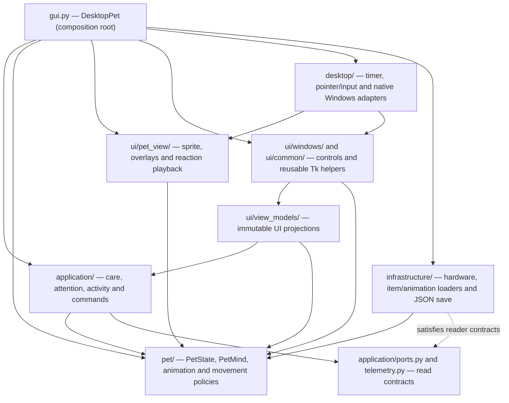

# Architecture — canonical pet and desktop UI packages

Aiko Desktop Pet is a local-first Windows companion built with Python 3.11+, Tkinter and prepared PNG artwork. The program requires no remote services or inference model at runtime. This document describes the **current code structure**, not the original v0.7–v0.13 implementation history.

The key design principle: **one owner per mutable state or external side effect**, with small, named interfaces between components. Imports point directly to the packages that own each responsibility.

## Dependency overview

The solid arrows highlight major code dependencies; the dotted provider-to-port
relationship represents structural compatibility, **not** an import from
infrastructure into the application. The checked-in tests enforce
additional import rules. Platform-level coordination intentionally happens
in the desktop shell; the architecture does not pretend to eliminate
all runtime coupling between composed services.

## State and business rules

**`pet/state.py — PetState`** is the only mutable, persisted pet aggregate. Its public `interact(action, now=...)` and `advance(now, ...)` operations commit care and elapsed-time state changes. Pure policy modules in `pet/` calculate immutable decisions:

- `care_actions.py`: `CareTransition` for care actions and their rewards.
- `need_decay.py`: `NeedLevels` for time and measured effort.
- `friendship.py`: relationship gains, cooldowns and daily limits.
- `lifecycle.py` and `routine.py`: bounded catch-up, sleep and daily schedule.

**`pet/mind/mind.py — PetMind`** selects reactions and maintains short-term conversational context. It does not own Tk windows or play sounds. `WorkloadEventDetector` in `pet/mind/workload_events.py` converts observed load changes into event keys. Authored Aiko dialogue remains in `aiko_pet/data/dialogues.de.json`; it is not regenerated by this refactor.

**`pet/mind/adaptive.py`** learns coarse local daily patterns from observations. Unknown hardware readings do not become fabricated activity. No application names, process titles or content are collected for this version.

`PetState.mood_hint()` now returns a typed `MoodHint` key from
`pet/status_hints.py`. The exact same pure policy works on the immutable
`PetReadSnapshot`; only `ui/view_models/text_de.py` selects German mood
wording. `PetState.due_meal()` returns a due meal ID, and the UI decides
whether to display a meal name or "Snack". Historical time-context text helpers
such as `TimeContext.greeting()` remain pending separate compatibility review.

## Application layer

- `CareController.execute()` advances pet time, coordinates the character's care event, applies the command and returns a presentation-independent `CareOutcome`.
- `ContactCoordinator` coordinates intentional cursor entry, user clicks and startup greetings through UI effect ports. `PetMind` still chooses all authored dialogue.
- `ApplicationRouter` accepts owner-thread care commands and validated, bounded incoming notifications. An external HTTP or IPC server is **not implemented**.
- `ActivityCoordinator` consumes hardware samples and coordinates adaptive observations and elapsed-time pet state.
- `AttentionCoordinator` controls spontaneous lines, non-interrupting notifications and idle gestures.
- `PetSessionRestorer` restores saved data through a narrow reader port without offline catch-up; the new running session receives a fresh time anchor.
- `PetReadSnapshot` is an immutable, language-neutral copy for presentation and potential future read-only adapters.
- `application/ports.py` describes capabilities such as `ComputerReadings`, not concrete OS drivers.

The application never imports Tkinter or native system monitor implementations.

## Pet animation, UI views and Tk widgets

Pet-owned pure behaviour lives in `pet/animation/` and `pet/movement/`:
`gaze.py` computes sixteen directional sectors, `ambient.py` schedules
subtle idle motion, `animation.py` owns frame-selection and timing policies,
`timing.py` validates already-decoded animation profiles, and the
`RandomWalkPlanner` selects departures separately from the `WalkController`'s
movement execution. `pet/mind/cursor_attention.py` retains only short-lived
pointer-attention timestamps, not operating-system access.

`ui/pet_view/` owns the concrete renderer and overlays:

- `AnimatedPet` draws the selected frame; it does not calculate random walk
  departures or own cursor-attention history.
- `WalkDriver` translates read-only conditions and host placement ports into
  safe displacement through the one pet-owned `WalkController`.
- `CharacterSpriteCache` handles runtime sprite frames, including lazy 2x
  variants. `RestPoseRenderer` handles pose-relative head motion, and
  `FoodOverlay` renders the selected hand item without affecting nutrition.
- `SpeechPresenter` and `ReactionPlayer` display timed text and emote cues.
  The pure need-based idle emote choice lives under `pet/animation/`.
- `ActionPlayback` owns the current visual action state and deadline, not the
  desktop shell. `CarePresenter` renders accepted care outcomes, including
  held items, reactions and status refreshes. `AttentionPresenter` translates
  approved spontaneous speech, idle gestures and notifications into visuals.

`ui/windows/` owns `HoverUi`, the pinnable `ActionToolbar`, `FoodMenu`,
`SettingsWindow`, and the rock-paper-scissors window. Controls are
independently movable where applicable. `ui/common/` owns reusable skin and
window-dragging helpers; `ui/view_models/` owns `DesktopPresentation`,
immutable status/hover/settings contracts, projections and localized UI copy.

No user-facing window owns PetState transitions. Actions are sent to the
application boundary through named callbacks. The pet sprite and the utility
windows are distinct UI owners even though both use Tkinter.

`presentation/`, `personality/` and the former root-level `ui/*.py` widget
forwarders have been **removed**. Runtime and tests import directly from the
owning `pet/`, `ui/`, or `infrastructure/` module. See the
[UI window contract](UI_WINDOW_CONTRACT.md).

## Desktop runtime and operating-system adapters

`gui.DesktopPet` is the composition root. It constructs the single graph of application, UI, desktop services and providers, wires callbacks and starts `DesktopLifecycle`.

- `DesktopRuntime` takes explicit `DesktopTickPorts` and owns the ordered 140 ms update cycle and timer IDs.
- `DesktopPreferences` coordinates the consequences of option changes without a second settings model.
- `application/settings.py` defines `PetSettings` as the single settings
  aggregate, composing `PetBehaviorSettings` and `DesktopDisplaySettings`.
  The historical flat properties and version-one JSON keys are preserved; no
  preference value is duplicated between the two child objects.
- `DesktopInput` owns Tk bindings, global click checks, pointer-coordinate sampling and cancellable delayed focus callbacks.
- `DesktopLifecycle` controls startup/shutdown ordering.
- `desktop/taskbar.py` and `window_stack.py` own Windows-specific taskbar discovery and z-order operations; `desktop/geometry.py` contains pure taskbar value calculations.

`infrastructure/character_assets.py` reads the prepared character catalog into immutable `pet/animation/character.py` contracts before Tk widgets are constructed. `infrastructure/animation_timing.py` owns JSON decoding while pure validation is in `pet/animation/timing.py`. Full-width frames and visible ground anchors preserve the wider sleeping pose. `tools/prepare_character_assets.py` retains the selected rebuild inputs and produces binary-alpha runtime PNGs. Runtime metadata retains historical source durations while each regular clip uses one constant frame hold, independently configurable in `assets/animation_timing.json` and validated when loaded. Walking currently uses 190 ms per frame (1.52 seconds per cycle); the idle blink is event-like with a 3–8-second rest interval and a one-source-pixel pose-relative head sway. Attack is cataloged but has no trigger. See [asset licensing](../ASSETS.md).

Hardware implementation details live in `infrastructure/hardware/`. `telemetry.ComputerSnapshot` is immutable and shared by the provider and application layers. The sampler uses local OS APIs and optional bounded NVIDIA tooling.

## Persistence, configuration and privacy

`infrastructure/persistence.py — StateStore` is the only implementation of the version-one atomic local JSON repository. The default Windows file is `%LOCALAPPDATA%\AikoDesktopPet\state.json`. The sole optional environment override, `AIKO_SAVE_PATH`, selects another **file path**. No `.env` is required.

- Storage decodes/writes data but does not simulate elapsed pet time.
  - The application restores saved values without offline catch-up. A shared
    `ActiveSessionClock` consumes each interval once across ticks, care, settings
    and saving. Windows uses unbiased interrupt time; Linux uses CLOCK_MONOTONIC.
    Standby and closed sessions do not consume needs or restore energy.
- Tests use temporary save files, never the user's production save.
- No cloud, login, browser integration, microphone listener or network service is started.

See [privacy and installation](../README.md#privacy-and-local-data) and [integration design](INTEGRATION_ARCHITECTURE.md) for future, explicitly unimplemented extension points.

## Import migration

The 2026-10-13 repository usage review found no runtime consumers of the 25
flat-module forwarding files or the five old application view modules.
Their imports were confined to tests and forwarding modules. `DesktopPet`
inherited `DesktopCompatibility`, but its live code already accessed the
owning components directly. `presentation/legacy.py` only supported the old
view modules and their tests. These 32 files have been removed, and the
behavior tests now exercise their canonical owners directly.

The source launchers (`main.py`, `Aiko_Pet.pyw`, `python -m aiko_pet` and both
Windows batch files) use `aiko_pet.gui.main` and require no import migration.
Version-one JSON saves, save-path configuration, sprites and authored dialogue
are unchanged. The repository review cannot establish whether unknown external
Python code imports the removed paths; such callers need the mappings below.

| Removed path under `aiko_pet` | Canonical owner |
| --- | --- |
| `domain` | `pet.state.PetState`; care/friendship/time constants and functions in their respective `pet` policy modules |
| `care_actions`, `friendship`, `need_decay`, `routine`, `value_rules` | Modules of the same name under `pet` |
| `pet_lifecycle` | `pet.lifecycle` |
| `adaptive`, `adaptive_models`, `adaptive_policy`, `work_episode`, `reaction_sequence` | Modules of the same name under `pet.mind` |
| `dialogue` | `pet.mind.mind.PetMind` and `pet.mind.catalog` types |
| `dialogue_catalog`, `dialogue_events` | `pet.mind.catalog`, `pet.mind.click_policy` |
| `computer_voice`; `ComputerVoice` alias | `pet.mind.workload_events.WorkloadEventDetector` |
| `animation`, `gaze`, `movement`, `reaction_playback` | `pet.animation`, `pet.movement`, `ui.pet_view.reaction_player` |
| `desktop_input` | `desktop.global_input` |
| `taskbar` | `desktop.taskbar` and `desktop.geometry.TaskbarTrack` |
| `window_stack` | `desktop.window_stack` |
| `storage` | `infrastructure.persistence.StateStore`; settings in `application.settings` |
| `system_activity` | Providers in `infrastructure.hardware`; shared snapshots/effort in `telemetry` |
| `application.view_models` | `ui.view_models.contracts` |
| `application.hover_projection`, `status_projection`, `settings_projection` | `ui.view_models.projections` |
| `application.read_models`; `presentation.legacy.DesktopViewSource` | `ui.view_models.read_models.DesktopPresentation` |
| `desktop.compatibility.DesktopCompatibility` | Owning `DesktopPet` components; no replacement facade |

Hover/status projectors accept `application.read_snapshot.snapshot_pet(state)`
instead of a mutable `PetState`. The status projector accepts the selected
emotion string rather than a `PetMind` object and timestamp. `DesktopPresentation`
provides desktop views without exposing the old public component handles.

Legacy desktop accesses such as `pet.toolbar`, `pet._bubble`, `pet.say()` and
`pet._walk_remaining` have been retired. Desktop composition and integration
tests use `pet._hover`, `pet._speech` and `pet._animated` respectively. These
are implementation components, not a new public integration API. Future
external adapters should use the typed application boundary.

Unused widget, asset and policy re-exports from `gui.py` have also been
removed; import them from their canonical `pet`, `ui`, `infrastructure`,
`asset_paths` or `desktop` modules.
The application uses `workload_events`, not the old `computer_voice` attribute.
Existing domain convenience methods and version-one data decoding remain
outside this module-import cleanup.

The `tests/test_canonical_import_paths.py` audit forbids references to
removed `personality/`, `presentation/` and root-level UI module paths in
production code, tools and tests. `tests/test_canonical_owner_identity.py`
checks implementation ownership without reviving obsolete compatibility tests.
There are no surviving import-forwarding packages for these historical paths.

## Refactor branch status (October 15, 2026)

This structure is being validated on the draft `refactor/pet-domain-ui-boundaries`
branch; the document becomes the maintained architecture after merge. The
migration does **not** implement World, new emotion values, object detection,
awareness, cursor fear, autonomous objects or drag-and-drop. Existing behavior,
assets and save-format invariants remain the acceptance criteria. All historical `presentation/`, `personality/` and root-level UI import
forwarders are removed. R2 animation-selection and R5 orchestration cleanup
continues; R6 has consolidated typed mood hints, due-meal selection and
single-assertion ownership tests. Relevant changes still require CI and
final-commit Windows verification before merge.

## Testing and contribution

GitHub Actions checks:

- Full Python 3.11 and 3.13 unit/Tk suites under Linux/Xvfb.
- Windows-hosted headless checks for native boundary logic.
- Ruff, PEP 8 line lengths, strict Mypy and Pyright.
- Domain invariants, immutable read data, import boundaries without legacy exceptions, and absence of module import cycles.

Native Windows layering, transparent-window and taskbar behavior must also be tested interactively for relevant changes. The October 2026 OOP refactor passed its full automated checks and received maintainer-reported Windows acceptance before [PR #2](https://github.com/Lexoniarus/aiko-desktop-pet/pull/2) merged.

For local commands, source changes and review expectations see [CONTRIBUTING.md](../CONTRIBUTING.md). Detailed refactor decisions are archived in [REFACTOR_ARCHITECTURE.md](REFACTOR_ARCHITECTURE.md) and the [dated architecture audit](ARCHITECTURE_AUDIT_20261013.md).
