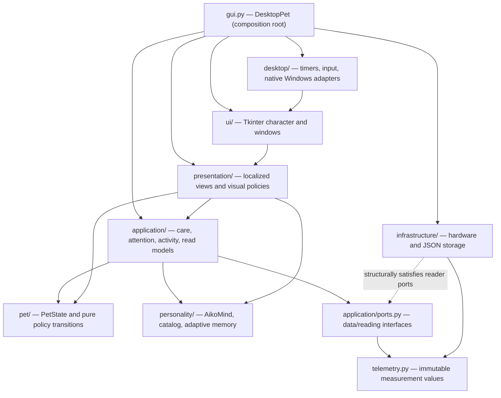

# Architecture — current `main`

Aiko Desktop Pet is a local-first Windows companion built with Python 3.11+, Tkinter and prepared PNG artwork. The program requires no remote services or inference model at runtime. This document describes the **current code structure**, not the original v0.7–v0.13 implementation history.

The key design principle: **one owner per mutable state or external side effect**, with small, named interfaces between components. Some public imports from earlier versions are retained for compatibility.

## Dependency overview

The solid arrows highlight major code dependencies; the dotted provider-to-port
relationship represents structural compatibility, **not** an import from
infrastructure into the application. The checked-in tests enforce
additional import rules. Platform-level coordination intentionally happens
in the desktop shell; the architecture does not pretend to eliminate
all runtime coupling between composed services.

## State and business rules

**`pet/state.py — PetState`** is the only mutable, persisted pet aggregate. Its public `interact(action, now=...)` and `advance(now, ...)` operations commit care and elapsed-time state changes. Pure policy modules in `pet/` calculate immutable decisions:

- `care_actions.py`: `CareTransition` for care actions and their rewards.
- `need_decay.py`: `NeedLevels` for time and measured effort.
- `friendship.py`: relationship gains, cooldowns and daily limits.
- `lifecycle.py` and `routine.py`: bounded catch-up, sleep and daily schedule.

**`personality/mind.py — AikoMind`** selects reactions and maintains short-term conversational context. It does not display windows or speak through an audio device. `WorkloadEventDetector` in `personality/workload_events.py` converts observed load changes into event keys; `ComputerVoice` remains a historical alias, not another detector. Authored dialogue is stored in `aiko_pet/data/dialogues.de.json`.

**`personality/adaptive.py`** learns coarse local daily patterns from observations. Unknown hardware readings do not become fabricated activity. No application names, process titles or content are collected for this version.

Some original domain convenience methods still return German text, such as `PetState.mood_hint()` and `TimeContext.greeting()`. They are retained for compatibility; **production status/hover copy** is formatted in `presentation/text_de.py`.

## Application layer

- `CareController.execute()` advances pet time, coordinates the character's care event, applies the command and returns a presentation-independent `CareOutcome`.
- `ApplicationRouter` accepts owner-thread care commands and validated, bounded incoming notifications. An external HTTP or IPC server is **not implemented**.
- `ActivityCoordinator` consumes hardware samples and coordinates adaptive observations and elapsed-time pet state.
- `AttentionCoordinator` controls spontaneous lines, non-interrupting notifications and idle gestures.
- `PetSessionRestorer` restores saved data through a narrow reader port and performs catch-up only for a valid existing save.
- `PetReadSnapshot` is an immutable, language-neutral copy for presentation and potential future read-only adapters.
- `application/ports.py` describes capabilities such as `ComputerReadings`, not concrete OS drivers.

The application never imports Tkinter or native system monitor implementations.

## Presentation and Tk widgets

`presentation/read_models.py` owns `DesktopPresentation`, converting pet read snapshots, typed settings and telemetry into immutable German `HoverSnapshot`, `StatusSnapshot` and `SettingsSnapshot` objects. `presentation/projections.py` formats display values; `presentation/text_de.py` owns German UI wording.

Concrete widgets belong under `ui/`:

- `AnimatedPet` draws Aiko and delegates animation-frame, gaze and walking calculations to pure presentation policies.
- `HoverUi` controls the toolbar, status window and settings popup independently from the animated character.
- `SpeechPresenter` manages the existing speech/emote overlay.
- `ActionToolbar` owns one cohesive widget, including its six bars, buttons, drag handling and visibility lifecycle.

`presentation/reaction_playback.py` performs the timed emote → text → optional follow-up sequence with cancellation.

## Desktop runtime and operating-system adapters

`gui.DesktopPet` is the composition root. It constructs the single graph of application, UI, desktop services and providers, wires callbacks and starts `DesktopLifecycle`.

- `DesktopRuntime` takes explicit `DesktopTickPorts` and owns the ordered 140 ms update cycle and timer IDs.
- `DesktopPreferences` coordinates the consequences of option changes without a second settings model.
- `DesktopInput` owns Tk bindings, global click checks and cancellable delayed focus callbacks.
- `DesktopLifecycle` controls startup/shutdown ordering.
- `desktop/taskbar.py` and `window_stack.py` own Windows-specific taskbar discovery and z-order operations; `desktop/geometry.py` contains pure taskbar value calculations.

Hardware implementation details live in `infrastructure/hardware/`. `telemetry.ComputerSnapshot` is immutable and shared by the provider and application layers. The sampler uses local OS APIs and optional bounded NVIDIA tooling.

## Persistence, configuration and privacy

`infrastructure/persistence.py — StateStore` is the only implementation of the version-one atomic local JSON repository. The default Windows file is `%LOCALAPPDATA%\AikoDesktopPet\state.json`. The sole optional environment override, `AIKO_SAVE_PATH`, selects another **file path**. No `.env` is required.

- Storage decodes/writes data but does not simulate elapsed pet time.
- The application applies bounded restoration, need decay and saved-state advancement.
- Tests use temporary save files, never the user's production save.
- No cloud, login, browser integration, microphone listener or network service is started.

See [privacy and installation](../README.md#privacy-and-local-data) and [integration design](INTEGRATION_ARCHITECTURE.md) for future, explicitly unimplemented extension points.

## Public compatibility policy

Earlier paths including `aiko_pet/domain.py`, `dialogue.py`, `adaptive.py`, `storage.py`, `system_activity.py`, `taskbar.py` and `application/read_models.py` re-export their canonical implementations. These are deliberate migration paths: they must not grow a second implementation.

`DesktopPet` still inherits `DesktopCompatibility` so older tests and consumers can read legacy attributes. The regular update scheduler does **not** rely on those forwards. Removing the façade, renaming public methods such as `AikoMind.say_event()` or changing persisted data requires a dedicated compatibility review rather than cosmetic renaming.

## Testing and contribution

GitHub Actions checks:

- Full Python 3.11 and 3.13 unit/Tk suites under Linux/Xvfb.
- Windows-hosted headless checks for native boundary logic.
- Ruff, PEP 8 line lengths, strict Mypy and Pyright.
- Domain invariants, legacy class identity, immutable read data, import boundaries, and absence of module import cycles.

Native Windows layering, transparent-window and taskbar behavior must also be tested interactively for relevant changes. The October 2026 OOP refactor passed its full automated checks and received maintainer-reported Windows acceptance before [PR #2](https://github.com/Lexoniarus/aiko-desktop-pet/pull/2) merged.

For local commands, source changes and review expectations see [CONTRIBUTING.md](../CONTRIBUTING.md). Detailed refactor decisions are archived in [REFACTOR_ARCHITECTURE.md](REFACTOR_ARCHITECTURE.md) and the [dated architecture audit](ARCHITECTURE_AUDIT_20261013.md).
