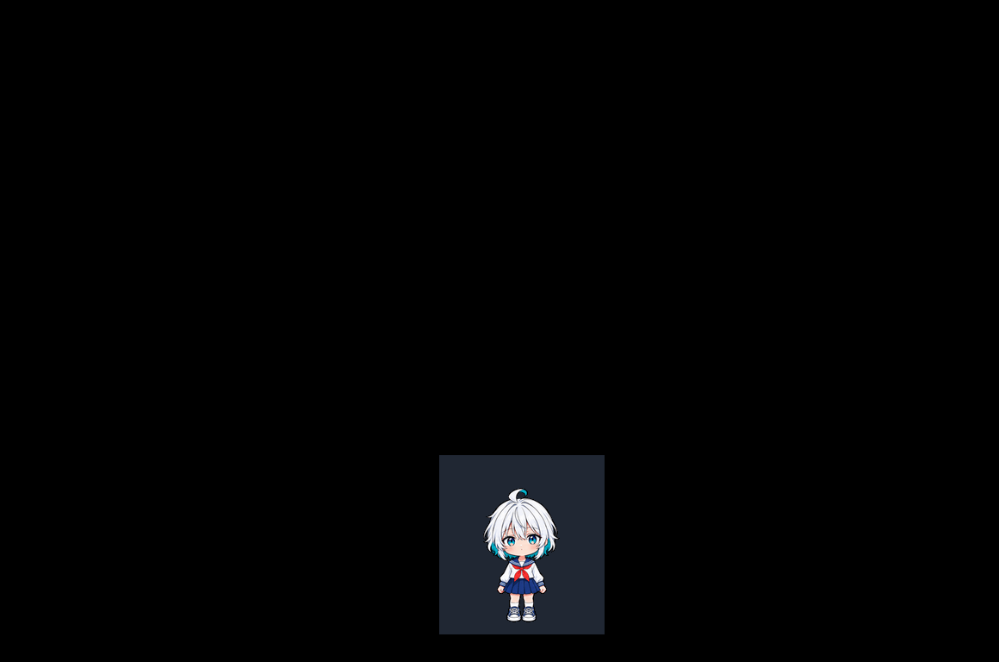

# Aiko Desktop Pet media gallery

The public gallery contains exactly the six media files used by the README.
The UI captures show the real Tk application under Linux/Xvfb; they are not
native Windows screenshots or performance measurements. Additional detail
stills have been removed. The captures are historical illustrations and may
predate the current mood-bar hierarchy and object-count details. Use the
[UI contract](UI_WINDOW_CONTRACT.md) for the current layout and the
[documentation index](README.md#validation-and-acceptance) for separately recorded
desktop acceptance; image filenames do not establish an exact-commit sign-off.

## Desktop overview


The toolbar owns care controls and optional inline status details. Settings
remain an independent persistent window. See the [window contract](UI_WINDOW_CONTRACT.md).

## Reactions and ambient behavior


The reaction GIF uses the real reaction player and speech presenter with
controlled cue progression. Emotes and dialogue occupy the same speech surface.



The ambient recording demonstrates the real Tk sprite, anchored feet,
subtle pose-relative head motion and all eight blink poses. Encoded hold
intervals illustrate pacing; they do not measure native Windows timer behavior.

## Character asset catalog


This sprite-only preview uses the prepared PNGs and per-pose holds from the
runtime manifest. It catalogs twelve eight-frame clips and sixteen static gaze
poses. It does not reproduce idle gaps or every derived greeting replay.
Source artwork is unchanged. See the [timing guide](ANIMATION_TIMING_PROFILE.md).

## Rock–Paper–Scissors


The player panel shows the player's own choice and session counters; Aiko's
bubble shows her own hand and reactions. Counters are not persisted.

## Manual capture and provenance

The developer-only capture commands are:

```bash
xvfb-run -a -s "-screen 0 1366x900x24" python -m tools.capture_current_gallery
xvfb-run -a -s "-screen 0 1366x900x24" python -m tools.capture_rock_paper_scissors_media
```

They require Pillow, Tk and Xvfb and write only these six files. There is no
automatic screenshot commit/push workflow. The [framing utility](../tools/media_crop.py)
captures the complete desktop and crops to the union of mapped application
windows with 24 pixels of padding, without rescaling. UI GIFs retain one
shared crop across frames.

Historical captures remain in Git history. Unused design references are
archived outside the repository. Character [asset terms](../assets/aiko-anime-8-frames/LICENSE.md),
[Kenney CC0](../LICENSES/KENNEY_CC0.md) and [Twemoji attribution](../LICENSES/TWEMOJI_CC_BY_4.md)
continue to apply. See [asset provenance](../ASSETS.md).
