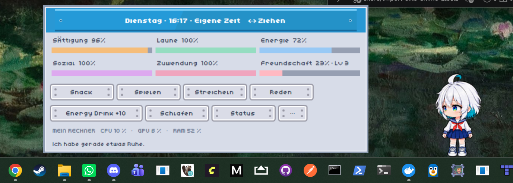
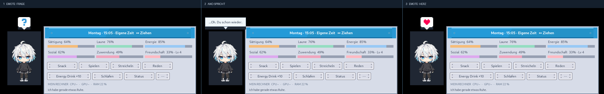
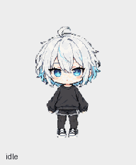

# Screenshots and animation gallery

These images are the **actual Aiko Desktop Pet visuals checked into the repository**. They are not newly generated design mockups. Unless otherwise marked, screenshots show the Tkinter application at the indicated historical feature baseline.

## Rock–Paper–Scissors minigame (feature-branch capture)

The player input panel contains the three hand buttons, a highlighted
**player-only reveal**, local session counters for rounds/wins/losses/draws,
and a Close button. Aiko reveals only **her own hand** through her original
character bubble, followed by her own emote, animation and result line.
The player score is never narrated by Aiko.

- [Opening view](../vorschau/Aiko_RPS_Start.png)
- [Separate reveal](../vorschau/Aiko_RPS_Aufgedeckt.png)
- [Scores after two completed rounds](../vorschau/Aiko_RPS_Punktestand.png)

These are **captured from the real Tk application under Linux/Xvfb**.
They are reproducible with
[`tools/capture_rock_paper_scissors_media.py`](../tools/capture_rock_paper_scissors_media.py)
and are not presented as captures of a native Windows desktop.
The historical screenshots and GIFs below are retained without modification.

## Current Aiko Anime character

This unmodified runtime screenshot was supplied by the project maintainer after
checking the new character integration. The current artwork contains twelve
eight-frame clips and sixteen static gaze directions, for 112 character poses.
Eating, petting and sleeping have dedicated animations; attack artwork is
stored for future use. Runtime timing applies a calm ambient/walking profile;
the original per-frame durations remain recorded in the runtime manifests.

## Historical v0.13 feature baseline

### Aiko and the sci-fi care panel

Six gauges show Aiko's five short-term needs and longer-term friendship. The panel appears on hover; Aiko's speech bubble is an independent overlay.

### A reaction in three steps

This GIF demonstrates a **sequential**, not simultaneous, emote → text → emote presentation. A new interaction can cancel a pending follow-up.

### Three captured stages

Separate source captures: [start emote](../vorschau/Aiko_v0_13_Emote_Start.png), [dialogue](../vorschau/Aiko_v0_13_Dialog_Mitte.png), [final emote](../vorschau/Aiko_v0_13_Emote_Abschluss.png), and [care panel with bubble](../vorschau/Aiko_v0_13_SciFi_und_Sprechblase.png).

## Original character animation preview

This historical GIF shows the previous 73-frame character artwork rather than
the full desktop UI. The current 112-pose character set is documented in
[ASSETS.md](../ASSETS.md) and the
[runtime provenance manifest](../aiko_pet/assets/provenance.json).

## Earlier UI and interaction history

The following images document historical versions; they are **not** illustrations of the latest panel styling.

| Feature baseline | Screenshot | Context |
| --- | --- | --- |
| v0.7 | [Speech and hover toolbar](../vorschau/Aiko_v0_7_Sprechblase_und_Leiste.png) | Early speech/toolbar separation |
| v0.7 | [Moved toolbar](../vorschau/Aiko_v0_7_Leiste_verschoben.png) | Independent drag position |
| v0.10 | [Click reaction](../vorschau/Aiko_v0_10_Klickreaktion.png) | Interactive dialogue |
| v0.10 | [Follow-up](../vorschau/Aiko_v0_10_Nachsatz.png) | A later dialogue beat |
| v0.11 | [Tamagotchi panel](../vorschau/Aiko_v0_11_Tamagotchi.png) | Older care/status layout |
| v0.12 | [Affection](../vorschau/Aiko_v0_12_Zuwendung.png) | Sixth gauge: affection plus friendship |

## Third-party design reference

[Kenney Sci-fi Sample reference](../vorschau/Kenney_SciFi_Sample_Referenz.png) is the **Kenney sample/reference layout**, *not* a screenshot of Aiko. It remains in the source history to document the inspiration for the adapted sci-fi UI.

## Asset attribution and reuse

The current Aiko Anime artwork has
[restricted reuse terms](../assets/aiko-anime-8-frames/LICENSE.md); historical
captures show the earlier MIT sprite release. UI screenshots also contain
Kenney graphics. The respective provenance and license boundaries are explained
in [ASSETS.md](../ASSETS.md),
[Kenney's CC0 notice](../LICENSES/KENNEY_CC0.md) and
[the sprite provenance manifest](../aiko_pet/assets/provenance.json).
Optional fonts are not bundled.

The unmodified screenshot/animation filenames under `vorschau/` are retained for compatibility with existing links and historical documents.
