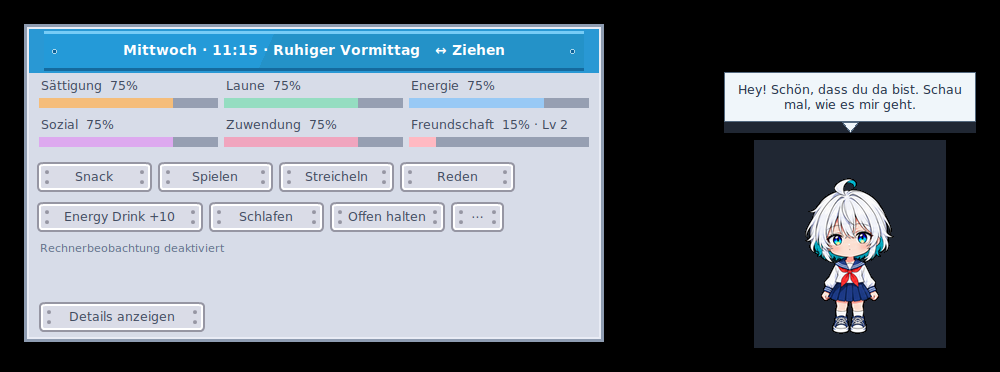
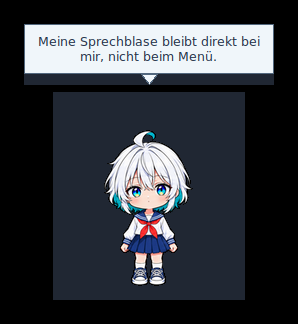
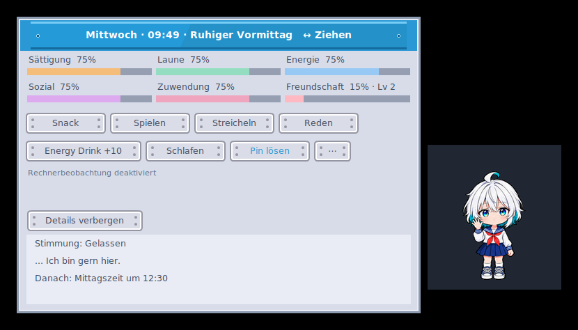
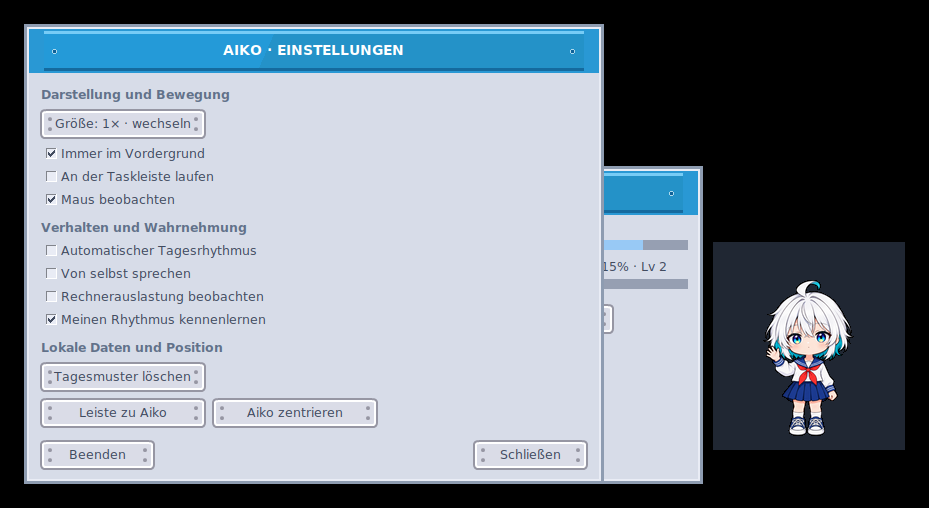
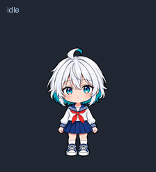

# Current Aiko Desktop Pet media gallery

All application screenshots and interaction GIFs displayed here were captured
from **the current Tk application running under Linux/Xvfb**, not rendered as
design mockups or represented as native Windows desktop screenshots.
The application targets Windows 10/11, and native Windows visual acceptance
remains separate. The runtime sprite preview is assembled solely from
the current 112 prepared character frames and their real timing manifest.

Older v0.7–v0.13 screenshots and the earlier 73-frame character GIF have been
retired from the current `vorschau/` directory. They remain in
[Git history at the pre-gallery-replacement commit](https://github.com/Lexoniarus/aiko-desktop-pet/tree/f41e8aab58e6a93bd2675d0fd1f1adc3bed9b345/vorschau)
for historical comparison, not as present-day screenshots.

## Current Aiko character and Kenney interface

The current 112-pose Anime character stands beside the light Kenney Sci-Fi
hover toolbar, with the existing independent character speech bubble.
The panel can be dragged separately from Aiko.

## Current status and settings

These are actual Tk utility windows. Values may be illustrative from the
temporary capture session; they are not claimed as real Windows device metrics.

## Sequential expressions, current character and emote skin

The sequence is presented through Aiko's existing ReactionPlayer and
SpeechPresenter. The capture script advances the real reaction cues
deterministically for reproducible stills and GIF timing.

| Cue | Current application still |
| --- | --- |
| Opening question emote | [Question emote](../vorschau/Aiko_Current_Reaction_Emote_Start.png) |
| Initial dialogue | [First line](../vorschau/Aiko_Current_Reaction_First_Line.png) |
| Follow-up line | [Follow-up](../vorschau/Aiko_Current_Reaction_Followup.png) |
| Closing heart emote | [Heart emote](../vorschau/Aiko_Current_Reaction_Emote_End.png) |

## Current Tamagotchi care visuals

| Interaction | Actual current Tk screenshot |
| --- | --- |
| Petting and affection emote | [Petting](../vorschau/Aiko_Current_Care_Pet.png) |
| Feeding and dedicated eating animation | [Feeding](../vorschau/Aiko_Current_Care_Feed.png) |
| Sleeping and breathing animation | [Sleeping](../vorschau/Aiko_Current_Care_Sleep.png) |

## Current 112-pose sprite animation preview

This is an **asset preview**, not an additional desktop screenshot. It uses
the runtime `aiko_pet/assets/frames/` PNG files and effective durations in
`aiko_pet/assets/animations.json`. The imported source art is unmodified.

## Rock–Paper–Scissors (merged into main)

The player window shows **only the player's own hand**, round count, player
wins, Aiko wins and draws. Aiko's character bubble displays only **her**
hand, emotes and contextual reactions. The player panel stays open until
closed, and its counters are never persisted.

- [Game opening](../vorschau/Aiko_RPS_Start.png)
- [Both distinct reveal surfaces](../vorschau/Aiko_RPS_Aufgedeckt.png)
- [Two rounds and local scores](../vorschau/Aiko_RPS_Punktestand.png)

## Capture provenance and reference material

The captures are reproducible using the developer-only
[`tools/capture_current_gallery.py`](../tools/capture_current_gallery.py)
and
[`tools/capture_rock_paper_scissors_media.py`](../tools/capture_rock_paper_scissors_media.py).
GitHub Actions runs the actual Tk app under Xvfb and commits the result to the
feature branch. Pillow is a development tool for screenshots/GIF encoding only.

The original third-party
[Kenney Sci-Fi sample layout](references/Kenney_SciFi_Sample_Referenz.png)
is archived as a **design reference**, not advertised as a current Aiko UI
screenshot.

Aiko's current character art has
[restricted reuse terms](../assets/aiko-anime-8-frames/LICENSE.md).
Kenney UI/emotes remain CC0 and the game hand illustrations remain CC BY 4.0.
See [artwork and screenshot provenance](../ASSETS.md),
[Kenney's notice](../LICENSES/KENNEY_CC0.md), and
[Twemoji's notice](../LICENSES/TWEMOJI_CC_BY_4.md).
